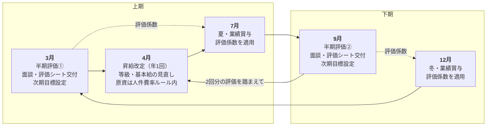

# 評価運用マニュアル（半期評価）

> 制度の設計そのものは「制度表（役割等級テーブル／評価制度／役割手当／賞与／監視ダッシュボード 等）」にあります。
> 本書は**それを実際に回すための手順書**です。様式は [半期評価シート](evaluation-sheet.md) を使います。
>
> **適用範囲：正社員のみ。** 役員は対象外（原資・人件費率の計算に参照するのみ）。
> 業務委託は**人事評価を行いません**（評価面談・目標設定・指揮命令は労働者性リスクのため実施しない）。
> 業務委託は年1回の契約更新時に、客観データに基づく**単価見直しを取引条件の交渉として**実施します★。
>
> ★ 印は未確定事項です。社労士確認前提のものは、確認完了まで★を外しません。
> 本書には**個人名・個別金額を記載しません**（[CLAUDE.md](../../CLAUDE.md) 機密情報ルール）。
> 制度表で個人名により記載されている評価者は、本書では**役職名**で表記します。

---

## 1. 年間の評価カレンダー



### 接続の読み方

| 評価 | 主に効く先 | 効き方 |
|---|---|---|
| **3月 半期評価** | 4月 昇給改定／7月 夏賞与 | 前年9月分と合わせた**2回分**で等級・基本給を判断。直近ランクが夏賞与の評価係数になる |
| **9月 半期評価** | 12月 冬賞与／翌4月 昇給改定 | ランクが冬賞与の評価係数になる。翌年3月分と合わせて翌4月の昇給判断へ |

> **等級・基本給が実際に動くのは4月だけ**です。9月の評価で等級が動くことはありません
> （9月の等級判定欄は「翌4月に向けた見立て」を記録するもの）。降格も同様に年1回・4月のみ。

### 月ごとの実務（半期評価月の進め方）

| いつ | 誰が | なにを |
|---|---|---|
| 評価月の**2ヶ月前**まで | 評価事務（総務役割） | KPIデータの出力を各データ保有者に依頼（対象3ヶ月と出力期限を明記） |
| 評価月の**1ヶ月前**まで | データ保有者 | Square実施データ・会員LTV分析シートを出力し、評価事務へ提出 |
| 評価月の**2週間前**まで | 評価事務 | 評価シートのKPI欄（2章）を実データで埋める。取れなかった軸は「欠測」と記入 |
| 評価月の**1週間前**まで | 本人 | 評価シートの「本人コメント」「ダイヤル申告」を記入して提出 |
| 評価月 | 一次評価者 | 面談を実施。所見・総合評価・等級判定を記入 |
| 面談後**1週間以内** | 二次確認者 | 内容を確認・署名。差し戻す場合は理由を書面で一次評価者へ |
| 二次確認後 | 一次評価者 | 本人へシートを交付（**交付日＝異議申立ての起算日**） |
| 交付後**2週間** | 本人 | 異議申立て期間 |
| 期初（3月・9月） | 本人×評価者 | 次期の目標を設定（シートの9章） |

---

## 2. 評価者・二次確認者の決め方

### 制度上の原則

| 区分 | 誰が務めるか |
|---|---|
| **一次評価者** | 店舗責任者／SV相当。**不在の場合は COO** |
| **二次確認者** | COO または 代表 ★要確定 |

### 現状の事実と、その帰結

**L4（店舗責任者・SV）は現在空席です**（3号店展開時に開くポストとして設計されている）。
したがって当面、**一次評価者は原則どおり COO が務める**ことになります。

これが評価運用に与える帰結を、そのまま認識しておく必要があります。

1. **一次と二次が同一人物になり得る。**
   一次＝COO、二次＝COO では二重チェックが機能しません。
   → **運用ルール：一次を COO が務める期は、二次確認者は必ず代表が務める**（同一人物の兼任を禁止）。
2. **評価者が1人に集中する。**
   全対象者の一次評価を1人が行うため、評価者の視点の偏りが結果に直結します。
   → **運用ルール：所見欄は必ず「観察した事実」を先に書く**（印象語のみの記載は不可）。
     二次確認者は事実記載のないシートを差し戻します。
3. **日常の観察者と評価者がずれる。**
   役員は日々の現場すべてを見ているわけではありません。
   → **運用ルール：一次評価者は、評価前に本人コメントを必ず読み、面談で事実を確認してから所見を書く。**
     推測で埋めない。
4. **L4が埋まるまで、この体制は「暫定」である。**
   → 3号店展開・L4登用のタイミングで評価者体制を見直します。
     L4候補者を将来の一次評価者として育てることを、評価者体制の課題として明記します。

### 評価者が務められない場合

| ケース | 対応 |
|---|---|
| 一次評価者が評価対象者本人と利害関係にある | 二次確認者が一次を代行し、もう一方の役員が二次に入る |
| 一次評価者が不在（休職・退職等） | COO が代行 |
| 一次・二次ともに務められる者がいない | **評価を実施せず延期する**（無理に評価しない）。延期の事実と理由を本人に書面で通知する |

---

## 3. 4軸KPIの判定手順

### 手順

1. **データ源から実数を取り出す。**
   - 量：Square実施データ（**シフト枠ではなく実施ベース**）
   - 顧客支持：Square実施データ（指名は**ベーシックプランの指名**が対象）
   - 質：会員LTV分析シート（担当スタッフ別継続率）
   - 役割：半期評価面談（ロール定義書に対する遂行）
2. **対象期間を先に決め、シートに書いてから数字を入れる。**
   量・顧客支持は**3ヶ月平均**。どの3ヶ月かをシートに明記します。
3. **出力者と出力日を記録する。** 後から数字が合わなくなったとき、定義の違いを特定するために必要です。
4. **軸ごとに「使用」か「欠測」かを確定する**（シート6章）。
5. **使えた軸だけで総合評価を組み立てる**（シート7章）。

### データが欠測している軸の扱い（原則）

> **原則1：欠測軸は評価に使わない。**
> 取れていない数字を推定で埋めて評価することはしません
> （[CLAUDE.md](../../CLAUDE.md)「未確定の数字を確定値として扱わない」）。
>
> **原則2：欠測を理由に本人を不利に扱わない。**
> データが取れていないのは会社側の整備不足であり、本人の責めに帰すものではありません。
> 「データがないから B より下」という判定はしません。
>
> **原則3：使えた軸のみで評価し、何を使ったかをシートに明記する。**
> 総合評価の根拠欄に「使用軸」「欠測軸」を必ず書きます。後から検証できるようにするためです。
>
> **原則4：使用軸が1軸以下のときは総合評価を確定させない。**
> シート7章で「判定保留」を選び、再判定の予定時期を書きます。
> 判定保留は不支給ではありません（後述 5-3 参照）。
>
> **原則5：欠測が続く軸は、評価ではなく経営課題として扱う。**
> 誰がいつまでにデータを整備するかを、評価とは別に決めます。

### 現時点で判定に影響する前提★

| 軸 | 前提となる未確定事項 | 確定するまでの扱い |
|---|---|---|
| 量 | 昇格要件の枠数基準（90枠×3ヶ月平均）は仮置き★ | 参考値として記載するにとどめ、単独で昇格・非昇格を決めない |
| 顧客支持 | 指名率の算出定義（分母）★／昇格要件の指名件数基準★ | 同上 |
| 質 | **主担当（カスタマー担当）の定義と複数担当時の按分ルールが未確定★** | 按分ルールが確定するまで**欠測扱い**とし、評価に用いない |
| 役割 | **ロール定義書が未整備★** | 暫定運用（下記）。暫定運用の結果は**降格・減額の根拠に用いない** |

### ロール定義書が未整備の場合の暫定運用

1. 面談の場で、本人と評価者が**その役割で担っている職務を3〜5項目書き出して合意**する。
2. その項目に対する遂行を評価する。
3. **暫定運用であること**、および**その結果を降格・減額の根拠には用いないこと**を本人に説明し、
   シート2-4のチェック欄にチェックする。
4. 書き出した項目は、次期のロール定義書の素案として引き継ぐ。

> 役割手当をロール定義書の整備前に支給する場合も同様に、**暫定運用である旨を対象者に説明します**。

---

## 4. ダイヤル条項の運用

> 育児・介護等のライフイベント時に、**量（実施枠数）のダイヤルを下げても、等級・基本給は下げません。**
> 役割ダイヤルで貢献を続けることで報酬を維持できます。復帰後に量を戻せば元の稼ぎ筋に戻ります。
> （出所：Mass Career Customization 型の4ダイヤル＝ペース・仕事量・役割・場所）★社労士確認前提。

### 運用ルール

| # | ルール |
|---|---|
| 1 | ダイヤルの申告（下げる／戻す）は**年1回の評価面談**で行う。**随時相談も可**とし、面談を待たせない |
| 2 | 量を下げている期間、**量KPIを降格判定・等級引き下げの根拠に用いない**（シート3章のチェックで担保） |
| 3 | 90枠（レッスンインセ基準）に届かないこと自体は**不利益ではない**。インセンティブの算定基準と評価は別概念 |
| 4 | 役割手当は量を下げても**継続可能**。総務・渉外・SNS・育成・顧客管理CSはいずれも枠数に依存しない設計 |
| 5 | 産休・育休・時短を理由とする評価の引き下げは行わない |
| 6 | 復帰時の等級再評価プロセス・申告様式は★要確定（社労士確認前提）。確定するまでは**現等級を維持**する |

### 産前産後休業・育児休業中の評価の扱い★

休業により評価対象期間の大半に就業実績がない場合の取り扱いは、
**不利益取扱いの禁止に関わるため、社労士確認を経てから確定します**。確定までの暫定運用：

- 面談は本人の希望と体調を優先し、**実施の可否・時期・方法（オンライン等）を本人に確認**する。
- 実績が存在しない軸は**欠測扱い**とし、評価に用いない（原則1・2と同じ）。
- 総合評価は原則**判定保留**とし、休業を理由としたランク引き下げは行わない。
- 等級・基本給・既に支給している手当は**維持**する。
- 復職時期・復職後の希望（枠数・役割・時間）をシート3章に記録し、復職後の配置検討の材料とする。

> ここに書いた暫定運用は**会社としての取り扱い方針**であり、法令解釈の断定ではありません。
> 休業中の評価・賞与算定期間の在籍要件・不利益取扱いの線引きは、いずれも★社労士確認事項です。

---

## 5. 降格・昇格・賞与への接続

### 5-1. 降格ルール

| # | ルール |
|---|---|
| 1 | **役割手当は役割を降りれば外れる。ただし等級・基本給とは連動させない**（等級を自動的に下げることはしない） |
| 2 | **等級の見直し（降格を含む）は年1回の評価でのみ行う。** 実際に変更が発生するのは**4月**のみ |
| 3 | 降格を実施する場合は**激変緩和措置**（段階的な減額・移行期間等）を設ける★具体設計は要確定 |
| 4 | L1→の降格の概念はない（育成中のため）。L2→L1、L3→L2、L4→L3 の降格要件は**未整備★** |
| 5 | 降格要件が未整備である以上、**現時点で降格を実施しない**。要件の確定（社労士確認含む）が先 |
| 6 | 量ダイヤルを下げている期間の量KPIは、降格判定に用いない（4章） |
| 7 | 暫定運用で行った役割評価の結果は、降格・減額の根拠に用いない（3章） |

### 5-2. 昇格の判定

| 昇格 | 要件（★すべて仮置き・要確定） |
|---|---|
| L1 → L2 | 実施60枠×3ヶ月平均 ＋ 一人で店舗運営が回る（チェックリスト★別途整備） |
| L2 → L3 | **役割チーフ就任**（役割認定とセット）＋ 次のいずれか：実施90枠×3ヶ月平均／指名30件/月／担当継続率が全店平均以上 |
| L3 → L4 | L3要件 ＋ 店舗損益 or 養成・育成実績（3号店展開・スクール整備に依存） |

> **役割ポストは限定枠（各役割1名想定）**です。ポストが埋まっている場合の代替昇格ルートは
> キャリアパス（3路線：マネジメント／専門／運営・渉外）で用意する設計ですが、
> 具体的な代替ルートは★要確定です。「ポストが空かないから上がれない」を放置しないこと。
>
> **昇格要件の数値基準が確定していない段階で、数値の未達を理由に昇格を見送らない**でください。
> 見送る場合は、数値ではなく「役割の引き受けが成立していない」等の事実で説明します。

### 5-3. 賞与評価係数への接続

```
個人賞与 ＝ 基本給 × 支給係数（プールから逆算・目安0.3〜1.0ヶ月分★） × 評価係数
```

| 評価 | 評価係数★ |
|---|---|
| S | 1.3 |
| A | 1.1 |
| **B（標準）** | **1.0** |
| C | 0.8 |

| # | 手順 |
|---|---|
| 1 | 賞与原資プール ＝ 算定期間の営業利益 × 還元率10%★ を算定する（会社レベル・機械的に決まる） |
| 2 | **支給条件(a)：算定期間の営業利益が黒字** であることを確認する。確認方法＝経理が締めた月次試算表の営業利益を算定期間で合算 |
| 3 | **支給条件(b)：支給を含む算定期間の人件費率が50%以内★** であることを確認する。確認方法＝下記の定義で算定期間の人件費率を算定 |
| 4 | (a)(b)いずれかを満たさない場合は**減額または不支給**（★規程に明記）。この場合、評価ランクが高くても支給額は保証されない |
| 5 | 支給係数をプールから逆算する |
| 6 | 各人の評価ランクから評価係数を適用する |
| 7 | **評価根拠を本人にフィードバックする**（係数だけ伝えて根拠を伝えない運用はしない） |

**判定保留の場合の扱い★**：総合評価が「判定保留」の対象者には、
**標準（B＝1.0）を適用する**ことを原則とします。データ欠測という会社側の事情で
本人の賞与を引き下げないためです。★この取り扱いの規程化は社労士確認事項です。

### 人件費率の定義に関する注意（重要）

**社内に2つの人件費率の定義が併存しています。混同すると判断を誤ります。**

| 出所 | 定義 | 目安 |
|---|---|---|
| [KPI定義集](../kpi/kpi-definitions.md) | （インストラクター報酬 ＋ 社員給与 ＋ 社会保険料）÷ 売上 | 45%以下 |
| 制度表 監視ダッシュボード | （給料手当 ＋ 外注費 ＋ 法定福利費 ＋ **役員報酬**）÷ 売上高 | 3ヶ月移動平均で48%警戒・50%凍結★ |

**違いは役員報酬を含むか否か**です。制度表側は**役員報酬込み**で算定しています。

- 賞与の支給条件(b)「50%以内★」の判定は、**制度表の定義（役員報酬込み・freee試算表の実額科目）**で行います。
- KPI定義集の45%と単純比較しないこと。比較する場合は必ず定義を揃えてから行います。
- **この2定義の関係（統合するか、別指標として併記するか）は経営マターとして整理が必要です★。**
  定義を変更する場合は、KPI定義集を先に更新し、エージェント定義・部署ドキュメントと3箇所を揃えます。

---

## 6. 人件費率が🔴凍結のときの評価結果の扱い

判定は**単月ではなく直近3ヶ月移動平均**で行います（単月スパイクで誤発動させないため）。

| 判定 | 3ヶ月移動平均 |
|---|---|
| 🟢 正常 | 48%以下 |
| 🟡 警戒 | 48%超 |
| 🔴 凍結 | 50%超 |

🔴が出たら役員決定で「凍結」を発動します。四半期ごとに解除判定（移動平均48%未満で解除）。

### 凍結＝「支出の伸びを止める」であり、既存の約束は守る

| 区分 | 具体的に何が止まる／止まらないか |
|---|---|
| **止めるもの（新たな増額）** | ・新規の役割手当付与<br/>・昇給（4月の基本給改定）<br/>・賞与の積み増し<br/>・新インセンティブの追加<br/>・昇格に伴う基本給の引き上げ |
| **止めないもの（既に支給中のもの）** | ・基本給<br/>・既に支給中の役割手当<br/>・確定済みインセンティブ（レッスン・指名・入会・継続）<br/>・既に決定済みの賞与 |

> 既に支給しているものを下げるには**不利益変更の手続きが必要**です。凍結はそれを行うものではありません。
> 従業員への説明も、この区分のとおりに行います。

### 評価運用そのものは止めない

| 項目 | 凍結時の扱い |
|---|---|
| 半期評価の実施・面談 | **止めない**（実施する） |
| 評価シートの交付・フィードバック | **止めない** |
| 総合評価ランクの確定 | **止めない**（評価は行う） |
| 等級判定の記録 | **止めない**（記録する） |
| 昇格に伴う**基本給の引き上げ** | **止まる**（凍結解除まで保留） |
| 新規の**役割手当付与** | **止まる** |
| 賞与の**評価係数の適用** | 支給自体が支給条件(b)に係る。50%超で支給条件を満たさない場合は減額・不支給★ |

> **評価を止めないことが重要です。**「評価したのに反映できない」と
> 「評価そのものをしない」は別物です。凍結中も評価は行い、
> **反映が保留になっている事実と、解除の条件（移動平均48%未満）を本人に説明します。**
> 昇格判定を記録しておけば、解除時に速やかに反映できます。

### 凍結時の説明文（本人向け・ひな形）

```
今回の評価結果は【　　】です。等級については【維持／昇格相当】と判定しました。
ただし現在、会社全体の人件費率が管理ライン（3ヶ月移動平均50%）を超えているため、
新たな増額（昇給・新規の役割手当）は一時的に保留しています。
これは評価内容とは関係のない、会社側の財務上の措置です。
既にお支払いしている基本給・手当・インセンティブは変わりません。
解除の条件は3ヶ月移動平均が48%を下回ることで、四半期ごとに判定します。
解除された時点で、今回の判定を反映します。
```

---

## 7. ★要確定事項の一覧

### A. 役員承認で決められるもの（社内決定事項）

| # | 項目 | 決めること |
|---|---|---|
| A1 | 評価対象期間の始期・終期 | 半期評価（3月・9月）と賞与算定期間（夏＝前年11月〜4月／冬＝5月〜10月）の対応 |
| A2 | 二次確認者の固定 | 一次をCOOが務める期は二次を代表が務める（兼任禁止）の明文化 |
| A3 | KPIデータの請求先と提出期限 | 誰がいつまでに出すかを運用ルールとして確定 |
| A4 | 判定保留時の賞与評価係数 | 標準（B＝1.0）適用を原則とする取り扱い（規程化は社労士確認） |
| A5 | ロール定義書の完成期限 | 担当と期限の確定 |
| A6 | 主担当（カスタマー担当）の定義・按分ルール | 質KPIと継続インセンティブの前提。確定するまで質軸は欠測扱い |
| A7 | 指名率の算出定義 | 分母を実施枠数とするかの確定 |
| A8 | 基本給是正の実施 | 是正幅・実施時期（役員承認事項。金額は本書に記載しない） |
| A9 | 役割認定 | 誰にどの役割を認定するか（ロール定義書とセット） |
| A10 | 人件費率2定義の整理 | KPI定義集45%と制度表50%（役員報酬込み）の関係を整理し、必要ならKPI定義集を先に更新 |
| A11 | 紹介インセンティブの判定方法 | Squareタグ等。確定まで支給保留のまま |
| A12 | 体験枠の配分ルール | 原則正社員優先配分の明文化 |

### B. 社労士確認が前提のもの（★を外さない）

| # | 項目 | 論点 |
|---|---|---|
| B1 | 降格要件（L2→L1／L3→L2／L4→L3） | 未整備。確定まで降格は実施しない |
| B2 | 激変緩和措置の具体設計 | 段階的減額・移行期間の設計 |
| B3 | 異議申立て手続き | 申立先・審査者・回答期限・様式 |
| B4 | 昇格要件の数値基準 | 枠数・指名数・継続率の基準値 |
| B5 | ダイヤル条項 | 申告様式・復帰時の等級再評価プロセス |
| B6 | 産休・育休中の評価の取り扱い | 不利益取扱いの禁止との関係 |
| B7 | 賞与の規程化 | 「業績により不支給あり」の明記、労働条件通知書「賞与あり」との整合 |
| B8 | 賞与の割増賃金算定基礎からの除外 | 一般に除外とされるが要確認 |
| B9 | 役割手当・各インセンティブの割増賃金算定基礎への算入可否 | 基本給是正（基本給化）は固定残業代の再計算にも影響 |
| B10 | 評価結果にもとづく減額の適法性 | 不利益変更手続きの要否 |
| B11 | 就業規則の届出義務の該当有無 | 常時使用労働者数・適用事業場の確認 |
| B12 | 過半数代表者の選出・意見聴取 | 適正な選出方法 |
| B13 | 廃止インセンティブの経過措置 | 個別説明→個別同意取得の順序は省略できない |
| B14 | 業務委託の労働者性 | 正社員と同額の指名料設計の影響。**業務委託には評価を行わない**運用の維持 |

> 労務・法務に関わる記述は本書でも断定していません。上記Bは**すべて社労士確認前提**です。

---

## 8. やらないこと

| # | やらないこと | 理由 |
|---|---|---|
| 1 | 取れていないKPIを推定値で埋めて評価ランクを付ける | 評価係数は賞与という実処遇に直結する。根拠なき評価は本人の不利益になる |
| 2 | 業務委託に人事評価・目標設定を行う | 労働者性リスク。単価見直しは取引条件の交渉として別途行う |
| 3 | 役員を本制度で評価する | 対象外（役員報酬は株主総会・取締役会決議） |
| 4 | 降格要件が未整備のまま降格を実施する | 不利益変更。要件確定・社労士確認が先 |
| 5 | 量ダイヤルを下げている人の量KPIで等級を下げる | ダイヤル条項の趣旨に反する |
| 6 | 評価シートに個別金額を書く | 機密情報ルール。処遇額は給与台帳側で管理 |
| 7 | 記入済み評価シートをリポジトリにコミットする | 同上 |
| 8 | 人件費率🔴を理由に評価そのものを中止する | 止めるのは「新たな増額」であって評価ではない |
| 9 | 評価係数だけを伝えて根拠を伝えない | 制度上、評価根拠のフィードバックは必須 |

---

関連：[半期評価シート](evaluation-sheet.md) ／ [KPI定義集](../kpi/kpi-definitions.md) ／ [月次経営会議アジェンダ](../templates/monthly-management-meeting.md)
